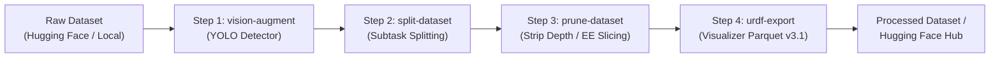

# Composable Dataset Pipelines

CLIrobot includes an extensible, declarative dataset pipeline engine ([`DatasetPipelineEngine`](../../clirobot/dataset/pipeline.py)) that allows robotics practitioners to compose, chain, and automate multi-step dataset manipulation recipes.

Instead of running separate ad-hoc scripts to prune features, generate object detection annotations, perform temporal task splitting, and push to the Hugging Face Hub, CLIrobot executes these steps sequentially in a clean, reproducible workflow.

---

## 🌟 How It Works



1. **Discovery**: CLIrobot discovers all plugins implementing [`DatasetTransformPlugin`](../../clirobot/plugins/base.py) across built-in adapters and installed packages.
2. **Recipe Validation**: The pipeline engine reads a YAML or JSON recipe file, validates that every transform step exists, and checks parameter schemas.
3. **Pipelined Execution**: Transforms execute sequentially. The output directory of step $N$ becomes the input dataset for step $N+1$.
4. **Hub Publishing**: The final stage can automatically push the transformed artifact to the Hugging Face Hub under a new repository ID.
5. **Dry-Run Preview**: Test and verify the full sequence of commands without downloading large datasets or writing data.

---

## 📋 Discovering Available Transforms

You can inspect all available dataset transformation tools registered across all active plugins with:

```bash
clirobot dataset transforms
```

Example output:

| Transform ID | Tool Name | Plugin | Description |
| :--- | :--- | :--- | :--- |
| `prune-dataset` | ✂️ Dataset Feature Pruner | `core-dataset` | Prune depth channels, strip RGB cameras, or slice 6-DoF EE states |
| `split-dataset` | 🔀 Annotation-Based Splitting | `core-dataset` | Split episodes temporally based on subtask, task_aug, plan, or speech annotations |
| `inspect-annotations`| 🔍 Annotation Inspector | `core-dataset` | Inspect and summarize annotations present in dataset |
| `vision-augment` | 👁️ Vision Object Detector | `vision-detector` | Run YOLO bounding box and segmentation mask augmentation |
| `urdf-export` | 🌐 URDF Visualizer Exporter | `dataset-visualizer` | Convert dataset to v3.1 Parquet with 3D joint URDF coordinate metadata |

---

## 📝 Recipe Format (YAML / JSON)

Recipes can be written in either YAML (`.yaml`, `.yml`) or JSON (`.json`).

### Recipe Schema

| Field | Type | Description |
| :--- | :--- | :--- |
| `input` | `string` | *(Optional)* Default Hugging Face repository ID (e.g. `user/raw-dataset`) or local directory path. |
| `meta` | `object` | Metadata about the pipeline (name, version, description, author). |
| `steps` | `array` | Sequential list of transformation steps to execute. |
| `steps[i].transform` | `string` | **Required.** The registered Transform ID (e.g. `vision-augment`, `prune-dataset`). |
| `steps[i].name` | `string` | *(Optional)* Friendly label for logs and UI output. |
| `steps[i].params` | `object` | Key-value dictionary matching the transform's parameter schema. |

---

## 🚀 Practical Recipe Examples

### Example 1: Clean & Compact Pipeline (`clean_dataset.yaml`)

This recipe takes a raw LeRobot dataset, strips heavy depth channels, slices 6-DoF actions down to essential gripper joints, and creates subtask-segmented episodes:

```yaml
meta:
  name: "Clean & Compact Manipulation Dataset"
  version: "1.0"
  description: "Removes depth images and splits episodes by temporal subtasks."

input: "lerobot/pusht_raw"

steps:
  - transform: "prune-dataset"
    name: "Remove Depth and Slices"
    params:
      strip_depth: true
      slice_action: "0:2"
      recompute_stats: true

  - transform: "split-dataset"
    name: "Temporal Subtask Split"
    params:
      strategy: "subtask"
      min_episode_len: 15
      reencode_video: true
```

### Example 2: Multimodal Vision Augmentation (`vision_pipeline.yaml`)

This recipe runs YOLOv8 object detection offline over camera frames to add bounding boxes and then exports Parquet files for the 3D web visualizer:

```yaml
meta:
  name: "Multimodal Vision Augmentation"
  version: "1.1"

input: "my-org/so100-pick-place"

steps:
  - transform: "vision-augment"
    name: "YOLO Object Detection"
    params:
      model: "yolov8m.pt"
      cameras:
        - "camera_top"
        - "camera_wrist"
      conf: 0.45
      save_annotated_video: true

  - transform: "urdf-export"
    name: "URDF Coordinate Export"
    params:
      format: "parquet_v3_1"
```

---

## 💻 CLI Usage

### 1. Dry-Run Validation

Preview the steps and verify parameters without modifying disk files:

```bash
clirobot dataset pipeline run recipes/clean_dataset.yaml --dry-run
```

Output:
```
╭────────────────── 🛠️ CLIrobot Dataset Pipeline ──────────────────╮
│ Pipeline Execution Plan: 2 step(s)                               │
│   • Initial Dataset: lerobot/pusht_raw                           │
│   • Final Hub Push:  False (None)                                │
│   • Dry Run:         True                                        │
╰──────────────────────────────────────────────────────────────────╯

Step 1/2: ✂️ Remove Depth and Slices
  [DRY RUN] Would prune dataset 'lerobot/pusht_raw' -> output: ./temp_pipeline/step_1
  [DRY RUN] Parameters: strip_depth=True, slice_action=0:2, recompute_stats=True

Step 2/2: 🔀 Temporal Subtask Split
  [DRY RUN] Would split dataset './temp_pipeline/step_1' -> output: ./output
  [DRY RUN] Strategy: subtask, min_episode_len=15

✔ All pipeline steps executed successfully!
```

### 2. Full Execution with Hub Upload

Run the recipe and upload the final transformed dataset directly to Hugging Face Hub:

```bash
clirobot dataset pipeline run recipes/clean_dataset.yaml \
  --input "my-org/raw-teleop-data" \
  --output-dir "./data/cleaned" \
  --push-to-hub \
  --hub-repo-id "my-org/cleaned-teleop-data"
```

### 3. Overriding Input & Output at Runtime

You can easily reuse existing recipes on different datasets via flags:
* `--input`, `-i`: Override the input dataset repository or directory.
* `--output-dir`, `-o`: Explicitly choose the final output directory.
* `--hub-repo-id`: Destination Hugging Face repo ID for publishing.
* `--push-to-hub`: Flag to trigger Hub upload upon final step completion.

---

## 🧩 Programmatic Execution via Python

You can also use [`DatasetPipelineEngine`](../../clirobot/dataset/pipeline.py) directly in your Python code:

```python
from clirobot.dataset.pipeline import DatasetPipelineEngine, PipelineStep

engine = DatasetPipelineEngine()

steps = [
    PipelineStep(
        transform="prune-dataset",
        params={"strip_depth": True, "slice_action": "0:6"},
    ),
    PipelineStep(
        transform="split-dataset",
        params={"strategy": "subtask"},
    ),
]

result = engine.run_pipeline(
    steps=steps,
    initial_input="my-org/raw-dataset",
    output_dir="./processed_data",
    push_to_hub=True,
    final_repo_id="my-org/processed-dataset",
)

if result.success:
    print(f"Pipeline finished! Output at: {result.final_output}")
```
