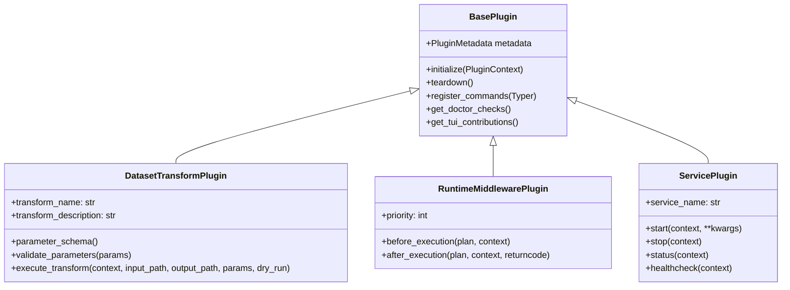

# Developing Custom Plugins for CLIrobot

CLIrobot features an open, modular plugin architecture that enables external robotics tools, data processing pipelines, and runtime middlewares to integrate seamlessly into CLIrobot's command-line interface, interactive TUI, and hardware profiles.

This guide provides a comprehensive walkthrough for building, packaging, and testing custom CLIrobot plugins.

---

## 🏗️ Architecture Overview

Plugins in CLIrobot inherit from one or more capability interfaces provided in [`clirobot.plugins.base`](../../clirobot/plugins/base.py):



* **`BasePlugin`**: The core contract. Handles discovery metadata, initialization with shared config, doctor diagnostics, TUI menu actions, and Typer CLI subcommands.
* **`DatasetTransformPlugin`**: Integrates data manipulation tools into CLIrobot's composable dataset pipeline engine.
* **`RuntimeMiddlewarePlugin`**: Intercepts, instruments, wraps, or modifies runtime execution plans (e.g. `lerobot-record`, `lerobot-teleoperate`) before and after invocation.
* **`ServicePlugin`**: Manages external daemon processes, web visualizers, or background servers with process lifecycle controls.

---

## ⚡ Quick Start: Creating a Plugin in 5 Minutes

Let's create a custom plugin called `clirobot-beeper` that plays audible sound cues when recording episodes start and finish.

### Step 1: Define the Plugin Class

Create a python file `beeper_plugin.py`:

```python
"""Beeper plugin for CLIrobot."""
from typing import List, Dict, Any
import shutil
import typer
from clirobot.plugins.base import (
    BasePlugin,
    RuntimeMiddlewarePlugin,
    PluginMetadata,
    PluginContext,
    ExecutionPlan,
    TUIMenuContribution,
)

class SoundCuePlugin(BasePlugin, RuntimeMiddlewarePlugin):
    @property
    def metadata(self) -> PluginMetadata:
        return PluginMetadata(
            name="sound-cue",
            version="1.0.0",
            author="Robotics Lab",
            description="Audible sound cues before and after LeRobot commands.",
            tags=["audio", "cues", "feedback"],
        )

    @property
    def priority(self) -> int:
        return 50  # Lower runs earlier, 50 is default middleware priority

    def initialize(self, context: PluginContext) -> None:
        self.context = context
        self.enabled = context.plugin_config.get("enabled", True)

    def before_execution(self, plan: ExecutionPlan, context: PluginContext) -> ExecutionPlan:
        """Inject a sound player command or beep before execution."""
        if self.enabled and plan.command_name in ("record", "teleop"):
            # Play a short high-pitch beep in background
            print("🔊 [SoundCue] Starting session cue...")
            plan.env["CLIROBOT_AUDIO_CUE"] = "1"
        return plan

    def after_execution(self, plan: ExecutionPlan, context: PluginContext, returncode: int) -> None:
        """Play completion or failure sound."""
        if self.enabled:
            status = "Success" if returncode == 0 else f"Failed (code {returncode})"
            print(f"🔊 [SoundCue] Session ended with status: {status}")

    def register_commands(self, parent_app: typer.Typer) -> None:
        """Register `clirobot beeper` commands."""
        beeper_app = typer.Typer(name="beeper", help="Sound cue controls.")

        @beeper_app.command("test")
        def test_sound():
            """Test the audible cue."""
            typer.echo("🔊 Beep! Beep! Sound cue test passed.")

        parent_app.add_typer(beeper_app)

    def get_doctor_checks(self) -> List[Dict[str, Any]]:
        """Contribute audio utility checks to `clirobot doctor`."""
        has_paplay = shutil.which("paplay") is not None
        has_aplay = shutil.which("aplay") is not None
        return [
            {
                "name": "Audio Player Utility (paplay / aplay)",
                "passed": has_paplay or has_aplay,
                "message": "Found audio backend" if (has_paplay or has_aplay) else "Install pulseaudio-utils or alsa-utils for sound cues",
            }
        ]

    def get_tui_contributions(self) -> List[TUIMenuContribution]:
        """Add audio cue test to TUI Control menu."""
        return [
            TUIMenuContribution(
                menu_path="control",
                label="🔊 Test Audio Cues",
                description="Play diagnostic beep sequence",
                action=lambda: print("🔊 Test Beep!"),
            )
        ]
```

---

## 📦 Packaging & Registration

CLIrobot supports two registration mechanisms:
1. **Python Package Entry Points** (Recommended for distributable packages and PyPI tools).
2. **Workspace Directory Discovery** (Ideal for local scripts, thesis projects, and custom lab plugins).

### Option 1: Entry Points in `pyproject.toml`

If your tool is a standalone pip/uv package (like `lerobot-vision-detector` or `FLAG-Embodied-data`), add the entry point in your `pyproject.toml`:

```toml
[project]
name = "clirobot-beeper"
version = "1.0.0"
dependencies = [
    "clirobot",
]

[project.entry-points."clirobot.plugins"]
sound-cue = "beeper_plugin:SoundCuePlugin"
```

Once installed into your virtual environment (`uv pip install -e .`), CLIrobot automatically detects, loads, and initializes it!

### Option 2: Directory Discovery

For rapid prototyping without installing a package, you can drop your Python file directly into one of CLIrobot's search directories:
* `~/.config/clirobot/plugins/`
* Any custom path configured via `clirobot config set plugin_search_paths '["/path/to/my/plugins"]'`

CLIrobot automatically inspects Python files in those directories for any class subclassing [`BasePlugin`](../../clirobot/plugins/base.py).

---

## 🛠️ Capability Mixins in Detail

### 1. `DatasetTransformPlugin`

Subclass this mixin if your plugin manipulates LeRobot datasets (e.g. data augmentation, video processing, filtering, subtask segmentation).

```python
from typing import Dict, Any, Optional
from clirobot.plugins.base import BasePlugin, DatasetTransformPlugin, PluginContext

class NoiseInjectionTransform(BasePlugin, DatasetTransformPlugin):
    @property
    def transform_name(self) -> str:
        return "add-joint-noise"

    @property
    def transform_description(self) -> str:
        return "Inject Gaussian noise into joint state actions for domain randomization."

    def parameter_schema(self) -> Dict[str, Any]:
        return {
            "std_dev": {
                "type": "float",
                "default": 0.02,
                "help": "Standard deviation of Gaussian noise."
            },
            "seed": {
                "type": "int",
                "default": 42,
                "help": "Random seed."
            }
        }

    def validate_parameters(self, parameters: Dict[str, Any]) -> None:
        if parameters.get("std_dev", 0.0) < 0:
            raise ValueError("std_dev cannot be negative.")

    def execute_transform(
        self,
        context: PluginContext,
        input_dataset_path: str,
        output_dataset_path: Optional[str] = None,
        parameters: Optional[Dict[str, Any]] = None,
        dry_run: bool = False,
    ) -> Dict[str, Any]:
        params = parameters or {}
        std_dev = params.get("std_dev", 0.02)

        if dry_run:
            return {"status": "dry-run", "input": input_dataset_path, "std_dev": std_dev}

        # Perform your dataset transformation here (e.g., using huggingface_hub or torch)
        print(f"Injecting noise (std={std_dev}) from {input_dataset_path} to {output_dataset_path}")
        return {"status": "success", "modified_samples": 1200}
```

Once registered, your transform is instantly accessible in:
* The CLI catalog: `clirobot dataset transforms`
* Direct execution: `clirobot dataset transform add-joint-noise --input-dataset path/to/data`
* Declarative pipeline recipes (`recipe.yaml`) executed via `clirobot dataset pipeline run`.

---

### 2. `RuntimeMiddlewarePlugin`

Subclass this mixin to intercept or wrap standard LeRobot commands (`record`, `teleop`, `replay`, `eval`, `train`).

Common use cases:
* **Prepend wrappers**: Running under `xvfb-run -a` or `nice -n -10`.
* **Inject arguments**: Adding custom camera configurations, `--display_cameras=true`, or frame recording paths.
* **Inject environment variables**: CUDA device pinning, ROS bridge configurations, or dataset variables.
* **Process monitoring**: Emitting telemetry, metrics, or resource consumption data.

```python
from clirobot.plugins.base import BasePlugin, RuntimeMiddlewarePlugin, ExecutionPlan, PluginContext

class HighPriorityMiddleware(BasePlugin, RuntimeMiddlewarePlugin):
    @property
    def priority(self) -> int:
        return 10  # High priority: wraps before other middlewares

    def before_execution(self, plan: ExecutionPlan, context: PluginContext) -> ExecutionPlan:
        # Prepend 'nice -n -5' for real-time robotic teleoperation priority
        if plan.command_name in ("teleop", "record"):
            plan.wrapper_command = ["nice", "-n", "-5"]
        return plan
```

---

### 3. `ServicePlugin`

Subclass this mixin to manage external daemon processes, visualization backends, or local web servers.

```python
import subprocess
from typing import Dict, Any
from clirobot.plugins.base import BasePlugin, ServicePlugin, PluginContext

class LocalTelemetryServer(BasePlugin, ServicePlugin):
    @property
    def service_name(self) -> str:
        return "telemetry-server"

    def start(self, context: PluginContext, **kwargs) -> Dict[str, Any]:
        # Start server as a background subprocess
        self.process = subprocess.Popen(["python", "-m", "http.server", "8080"])
        return {"status": "running", "pid": self.process.pid, "port": 8080}

    def stop(self, context: PluginContext) -> Dict[str, Any]:
        if hasattr(self, "process") and self.process:
            self.process.terminate()
            return {"status": "stopped"}
        return {"status": "not_running"}

    def status(self, context: PluginContext) -> Dict[str, Any]:
        is_alive = hasattr(self, "process") and self.process.poll() is None
        return {"running": is_alive, "pid": getattr(self.process, "pid", None)}

    def healthcheck(self, context: PluginContext) -> bool:
        return hasattr(self, "process") and self.process.poll() is None
```

---

## 🔍 Managing Plugins via CLI

CLIrobot provides built-in commands to inspect, enable, and configure plugins:

```bash
# List all discovered plugins and their active status
clirobot plugin list

# Inspect detailed metadata and capabilities
clirobot plugin info vision-detector

# Enable or disable a plugin
clirobot plugin disable sound-cue
clirobot plugin enable sound-cue

# Register an external directory or repository path
clirobot plugin add /home/user/my-custom-robot-plugins
```

---

## 🧪 Testing Your Plugin

You can verify your plugin's functionality using standard `pytest`:

```python
import pytest
from clirobot.plugins.base import PluginContext, ExecutionPlan
from beeper_plugin import SoundCuePlugin

def test_sound_cue_plugin():
    plugin = SoundCuePlugin()
    context = PluginContext(
        active_profile="default",
        workspace_root="/tmp",
        plugin_config={"enabled": True},
    )
    plugin.initialize(context)

    # Test ExecutionPlan modification
    plan = ExecutionPlan(
        command_name="record",
        command_args=["--robot-path", "/dev/ttyACM0"],
    )
    modified_plan = plugin.before_execution(plan, context)
    assert modified_plan.env.get("CLIROBOT_AUDIO_CUE") == "1"

    # Test Doctor checks
    checks = plugin.get_doctor_checks()
    assert len(checks) >= 1
```

Run tests with `uv`:
```bash
uv run pytest tests/test_my_plugin.py -v
```
